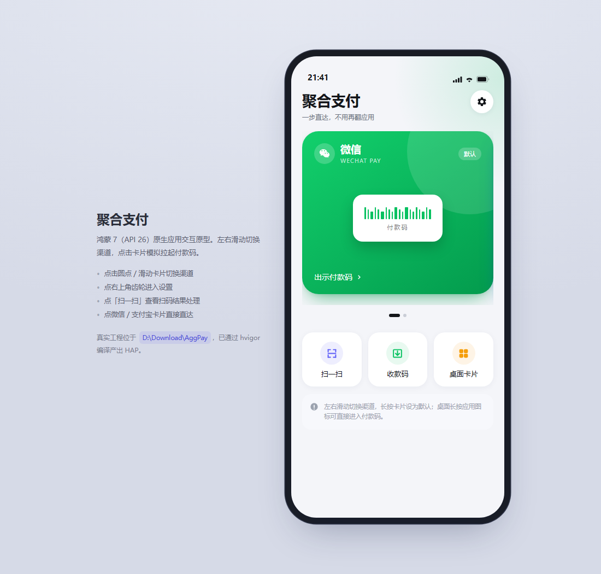
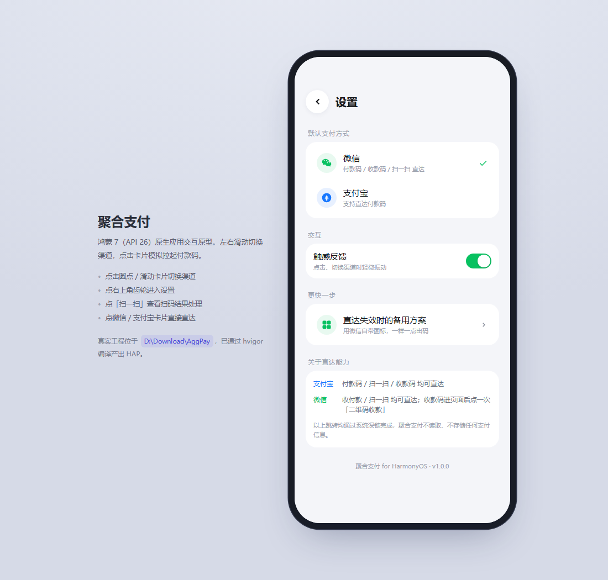
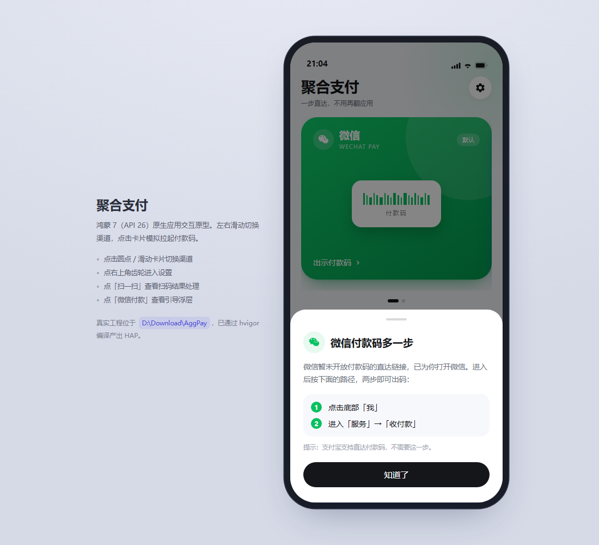
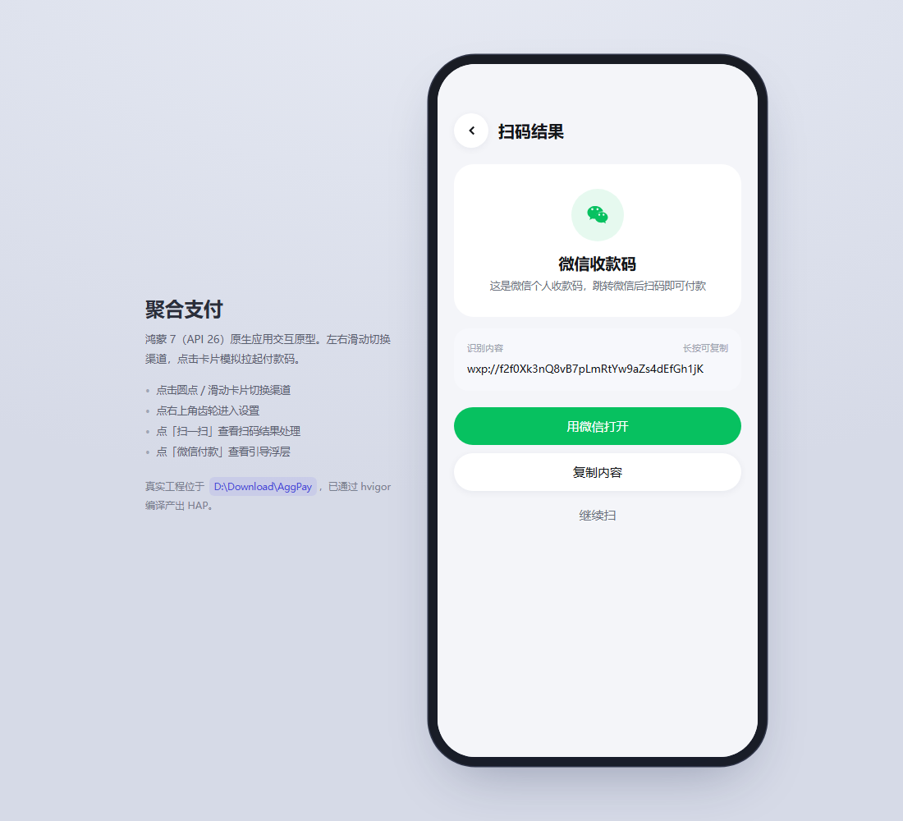
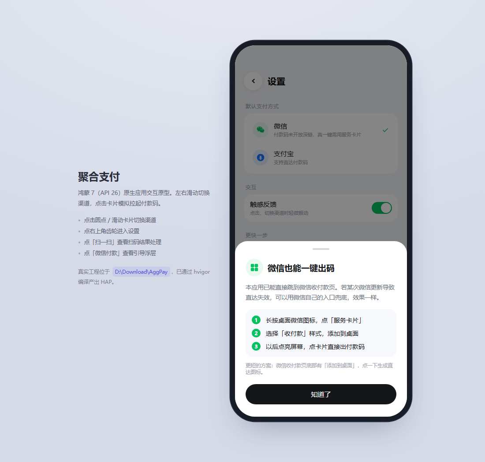
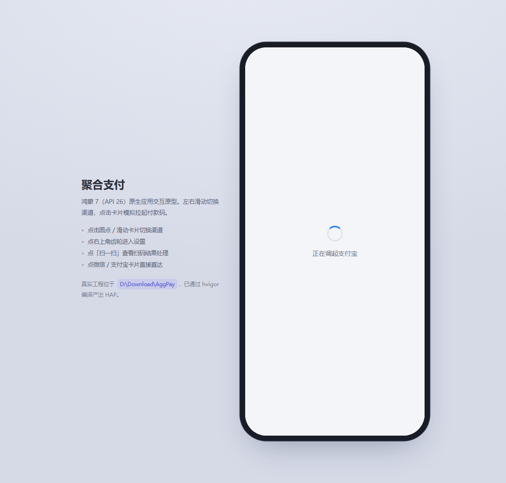

# 聚合支付 · AggPay for HarmonyOS

鸿蒙（HarmonyOS 6.0 / API 26，即鸿蒙 7 代际）原生聚合支付快捷入口。参考魅族 Flyme 聚合支付的产品形态：**一屏聚合微信与支付宝，左右滑切换，点击直达付款码**，并提供桌面卡片与长按快捷方式。

| 首页 | 设置 | 微信直达引导 |
| --- | --- | --- |
|  |  |  |

| 扫码结果 | 服务卡片引导 | 调起过渡层 |
| --- | --- | --- |
|  |  |  |

可交互原型：[`docs/prototype/index.html`](docs/prototype/index.html)（浏览器直接打开，1:1 还原视觉与滑动交互）。

---

## 1. 环境与构建

| 项 | 版本 |
| --- | --- |
| DevEco Studio | 26.0 |
| SDK | HarmonyOS 26.0.0（API 26） |
| 构建 | hvigor 6.26.9 |

> **路径限制**：鸿蒙构建要求工程路径只含字母、数字、`-`、`_`、`.`、空格、`()`、`@`。当前工程放在 `D:\Download\AggPay`（纯英文），**不要**移动到含中文的目录，否则 hvigor 会报 `Invalid project path`。

### 用 DevEco Studio（推荐）

1. `File → Open` 打开 `D:\Download\AggPay`
2. 首次打开等待 Sync 完成
3. `File → Project Structure → Signing Configs` 勾选 **Automatically generate signature**（需登录华为账号）
4. 连接真机或启动模拟器，`Run 'entry'`

### 命令行

```bash
cd /d D:\Download\AggPay
set DEVECO_SDK_HOME=D:\Huawei\DevEco Studio\sdk
set NODE_HOME=D:\Huawei\DevEco Studio\tools\node
hvigorw.bat --mode module -p product=default assembleHap --no-daemon
```

产物：`entry\build\default\outputs\default\entry-default-unsigned.hap`

---

## 2. 目录结构

```
AggPay/
├── AppScope/
│   ├── app.json5                      bundleName: com.aggpay.harmony
│   └── resources/base/media/          分层图标（background / foreground / app_icon）
├── entry/src/main/
│   ├── module.json5                   querySchemes、服务卡片、shortcuts 元数据
│   ├── ets/
│   │   ├── entryability/EntryAbility.ets        冷/热启动参数消费、沉浸式
│   │   ├── entryformability/EntryFormAbility.ets 桌面卡片宿主
│   │   ├── pages/Index.ets            主面板（Swiper 双渠道卡）
│   │   ├── pages/SettingsPage.ets     默认渠道 / 触感 / 能力说明
│   │   ├── pages/ScanResultPage.ets   扫码结果智能分发
│   │   ├── view/ChannelCard.ets       品牌渐变卡片
│   │   ├── view/QuickAction.ets       快捷入口
│   │   ├── model/PayChannel.ets       渠道定义 + 深链组装
│   │   ├── service/PayLauncher.ets    跨应用跳转（openLink → startAbility 兜底）
│   │   ├── service/ScanService.ets    Scan Kit 默认扫码界面
│   │   ├── service/ScanRouter.ets     扫码结果分类
│   │   ├── common/SettingsStore.ets   首选项持久化
│   │   └── common/Haptics.ets         触感反馈
│   └── resources/base/profile/
│       ├── main_pages.json            页面路由（API 26 用 "src" 字段）
│       ├── form_config.json           服务卡片配置（2×2 / 2×4 / 1×2）
│       └── shortcuts_config.json      长按应用图标的快捷菜单
```

---

## 3. 核心实现

### 3.1 跨应用直达

`module.json5` 必须声明允许查询的 scheme，否则系统以 `17700056` 拦截：

```json5
"querySchemes": ["weixin", "alipays", "alipay", "unionpay"]
```

跳转采用三级策略（`PayLauncher`）：

1. `context.openLink(uri, { appLinkingOnly: false })` —— 走 deep link
2. 失败则 `startAbility({ bundleName, action: 'ohos.want.action.viewData', uri })` —— 显式包名兜底
3. 仍失败返回提示，不静默失败

### 3.2 深链表

| 渠道 | 付款码 | 扫一扫 | 收款码 |
| --- | --- | --- | --- |
| 支付宝 | `alipays://platformapi/startapp?appId=20000056` | `alipays://platformapi/startapp?appId=10000007-20000067` | `alipays://platformapi/startapp?appId=20000123` |
| 微信 | `weixin://`（仅到首页） | `weixin://scanqrcode` | `weixin://` |

深链集中在 `model/PayChannel.ets` 的 `buildUri()`，目标应用调整参数时只改这一处。

### 3.3 快捷启动的三条路径

- **桌面服务卡片**（2×2）：`postCardAction(router)` 带 `channel` / `mode` 参数拉起 `EntryAbility`
- **长按应用图标**：`shortcuts_config.json` 提供「微信付款码 / 支付宝付款码 / 扫一扫」
- **应用内滑切**：`Swiper` 双卡 + `DotIndicator`

参数统一写入 `AppStorage`，首页通过 `@StorageLink + @Watch` 消费，冷启动（`onCreate`）与热启动（`onNewWant`）都能命中，落点是「打开即直达」，不需要用户再点一次。

### 3.4 扫码

`scanBarcode.startScanForResult()` 拉起系统扫码界面（自动对焦/曝光，自带相册识码），**无需申请相机权限**。扫完按内容类型分流：

| 内容 | 处理 |
| --- | --- |
| `wxp://…` | 识别为微信收款码 → 拉起微信 |
| `https://qr.alipay.com/…` | 支付宝收款链接 → 直接拉起 |
| `alipays://` / `weixin://` | 对应 App 打开 |
| `http(s)://` | 系统浏览器 |
| 其他 | 展示 + 复制 |

---

## 4. 能力边界（重要）

这是鸿蒙生态的现实约束，不是实现缺陷：

**微信也可以一键直达，走的是「快捷方式参数」，不是 scheme。**

微信把「收付款 / 扫一扫 / 我的二维码」注册成了系统快捷方式，每个只带一个参数：

```
shortCutKey = shortCutPay      // 收付款
shortCutKey = shortCutScan     // 扫一扫
shortCutKey = shortCutMyQrCode // 我的二维码
```

真机 `bm dump -n com.tencent.wechat -s` 可读到 `id_pay` 的 intents，目标为 `entry/EntryAbility`，`parameters = {"shortCutKey":"shortCutPay"}`。微信在 EntryAbility 里直接读这个参数并跳页，**不校验调用方也不校验签名**，所以第三方显式拉起时带同样参数即落到同一页面（真机冷启动已验证）。

实现见 `service/PayLauncher.ets` 的 `launchByShortcut()`：`startAbility({ bundleName, moduleName: 'entry', abilityName: 'EntryAbility', parameters: { shortCutKey } })`。这是**非公开契约**，微信改版可能失效，因此保留了兜底：失败时退回 `weixin://` 并弹出「我 → 服务 → 收付款」引导。

| 渠道 | 付款码 | 扫一扫 | 收款码 |
|---|---|---|---|
| 微信 | 直达 `shortCutPay` | 直达 `shortCutScan` | 进收付款页后点一次「二维码收款」 |
| 支付宝 | 直达 `appId=20000056` | 直达 `appId=10000007` | 直达 `appId=20000123` |

支付宝的这三个 appId 同样来自它自己的长按快捷方式（`bm dump -n com.alipay.mobile.client -s`），拉起时还须带 `source=Harmony3DTouch`，否则只传 appId 会落到首页。两者都收敛在 `model/PayChannel.ets` 的 `launchParamsOf()`。

微信没有为「收款码」单独注册快捷方式，故收款码仍需一次点击；想零点击可用微信自带兜底入口：收付款页底部「添加到桌面」，或长按微信图标加「收付款」服务卡片。

**支付宝是全链路的。** 付款码、扫一扫、收款码都能通过 `startapp` 路由直达，体验与魅族聚合支付一致。

---

## 5. 可扩展方向

- 接入 `@kit.PaymentKit`（需商户资质）做真正的收银台聚合
- 服务卡片增加「最近使用」动态数据（`updateEnabled: true` + `formProvider`）
- 渠道从 2 个扩展到云闪付 / 数字人民币（`ALL_CHANNELS` 加一项 + 卡片自动多一屏）
- 长按卡片拖拽排序（`Grid` + `onItemDragStart`）

---

## 6. 隐私

应用不读取、不上传任何支付信息，仅做系统级深链跳转；无网络请求，无账号体系，无埋点。
